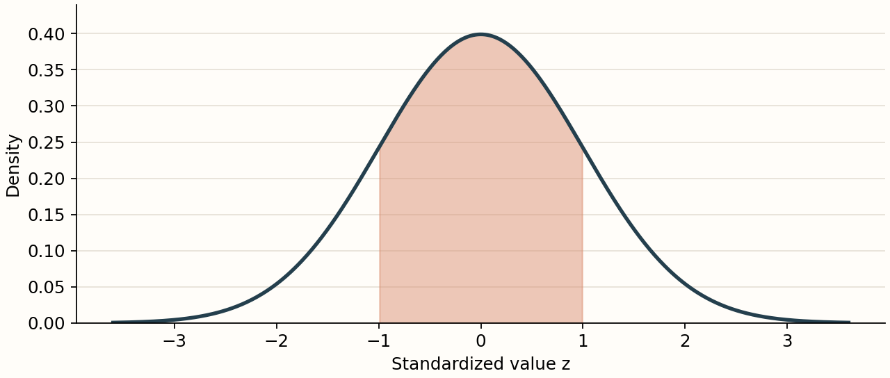

:::{div}
:class: custom-class-lead

Use this page as a visual regression specimen. Check hierarchy, line length,
spacing, contrast, and the relationships between neighbouring components.
:::

## Paragraphs and inline elements

A useful theme makes an ordinary paragraph comfortable to read. This sample
contains **bold text**, *emphasis*, ***bold emphasis***, and `inline_code()`.
There is an [internal link to the notebook](notebook.ipynb), an
[external link to the MyST guide](https://mystmd.org/guide), and a
footnote reference.[^specimen] Inline mathematics such as $x_i$, $\mu$, and
$\hat{\sigma}^2$ should sit naturally on the same baseline as the text.

A second paragraph makes the vertical rhythm easier to judge. Long lines
should remain readable on a wide display, while small screens should wrap
the prose without making the entire page scroll horizontally. Punctuation,
including “quotation marks”, an apostrophe, an en dash, and an em dash—should
render consistently.

> A block quotation should be recognizably distinct from the surrounding
> prose, with enough contrast to remain easy to read in both colour modes.

### A level-three heading

Short explanatory paragraphs often follow intermediate headings. The gap
above a heading should communicate a stronger break than the gap below it.

#### A level-four heading

Subsections still need a clear place in the visual hierarchy.

##### A level-five heading

Small headings should remain distinguishable from bold inline text.

###### A level-six heading

This is the smallest heading in the specimen. The page title above supplies
the level-one heading.

## Lists and definition lists

- An unordered item with a short sentence.
- An item with **emphasis** and inline math $n = 30$.
- A longer item that wraps naturally when viewed on a narrow screen and
  demonstrates the indentation used for continuation lines.

1. State the statistical question.
2. Inspect the data.
3. Choose an analysis whose assumptions fit the setting.

Population
: The collection or data-generating process about which we want to learn.

Sample
: The observations available for an analysis.

## Tables

| Group | Sample size | Mean | Standard deviation |
| :--- | ---: | ---: | ---: |
| Control | 30 | 100.4 | 12.7 |
| Treatment | 32 | 108.2 | 13.1 |
| Follow-up | 28 | 105.9 | 11.8 |

This table tests header styling, alternating rows if enabled, borders,
numeric alignment, and the spacing before and after a table.

## Images and captions

This image is included with ordinary Markdown syntax:



The same local asset is included below with a MyST figure directive, so
caption typography and figure cross-references can be checked separately.

```{figure} ../assets/normal-density.png
:label: fig-normal-density
:alt: Standard Normal density with the interval from minus one to plus one shaded.
:width: 75%

The standard Normal density, with the region $-1 \leq z \leq 1$ shaded.
This caption is long enough to wrap on a phone-sized display.
```

See [the density figure](#fig-normal-density). The generated image is included
in `assets/`; no external image URL is required.

## Inline and display mathematics

For observations $\mathbf{x} = (x_1, \ldots, x_n)$, the sample mean is
$\overline{x} = \frac{1}{n}\sum_{i=1}^{n} x_i$. Check that the fraction does
not create excessive line spacing in this paragraph.

$$
  s^2 = \frac{1}{n-1}\sum_{i=1}^{n}
        \left(x_i - \overline{x}\right)^2.
$$

```{math}
:label: eq-standard-error

\widehat{\operatorname{se}}(\overline{x})
  = \frac{s}{\sqrt{n}}.
```

The [estimated standard error](#eq-standard-error) is a useful short
equation for checking numbering and cross-reference styles.

$$
\begin{aligned}
\operatorname{E}[\overline{X}] &= \mu, \\
\operatorname{Var}(\overline{X}) &= \frac{\sigma^2}{n}.
\end{aligned}
$$

$$
\mathbf{A} =
\begin{pmatrix}
  1 & 0 & -1 \\
  0 & 2 & 3
\end{pmatrix},
\qquad
f(z) = \frac{1}{\sqrt{2\pi}}\exp\!\left(-\frac{z^2}{2}\right).
$$

## Code fences

These fences are text examples; they are not executed by the book builder.

```python
from scipy.stats import norm

rv = norm(loc=100, scale=15)
probability = rv.cdf(115) - rv.cdf(85)
print(f"Probability: {probability:.3f}")
```

```yaml
site:
  template: book-theme
  options:
    style: theme/custom.css
```

```text
A deliberately long code line: abcdefghijklmnopqrstuvwxyz_ABCDEFGHIJKLMNOPQRSTUVWXYZ_0123456789_abcdefghijklmnopqrstuvwxyz_ABCDEFGHIJKLMNOPQRSTUVWXYZ_0123456789
```

## Admonitions and a dropdown

```{note}
A note is a good place to check the information colour, title, icon,
border, and paragraph spacing. It can contain inline math $p = 0.05$.
```

```{tip}
Switch between light and dark modes after changing the palette.
```

```{warning}
A warning needs a distinct visual treatment without reducing the
legibility of its text.
```

```{danger}
This is an error-style content block. It is a styling specimen, not a
failed notebook cell.
```

```{dropdown} Expand this explanation
This content tests the expanded state and the spacing inside a dropdown.

$$\Pr(A \cap B) = \Pr(A)\Pr(B \mid A).$$
```

## Tabs

::::{tab-set}
:::{tab-item} Interpretation
The sample mean estimates the population mean.
:::
:::{tab-item} Formula
$\overline{x} = \frac{1}{n}\sum_{i=1}^{n} x_i$.
:::
::::

## A custom component class

:::{div}
:class: custom-class-card

### A card controlled by your own CSS

This block uses a class defined in `theme/custom.css`. It is a convenient
place to experiment without depending on a generated Tailwind utility name.

[Continue to the executable notebook](notebook.ipynb).
:::

[^specimen]: Footnotes exercise smaller text, backlink styling, and the space
    separating supporting information from the main body.

